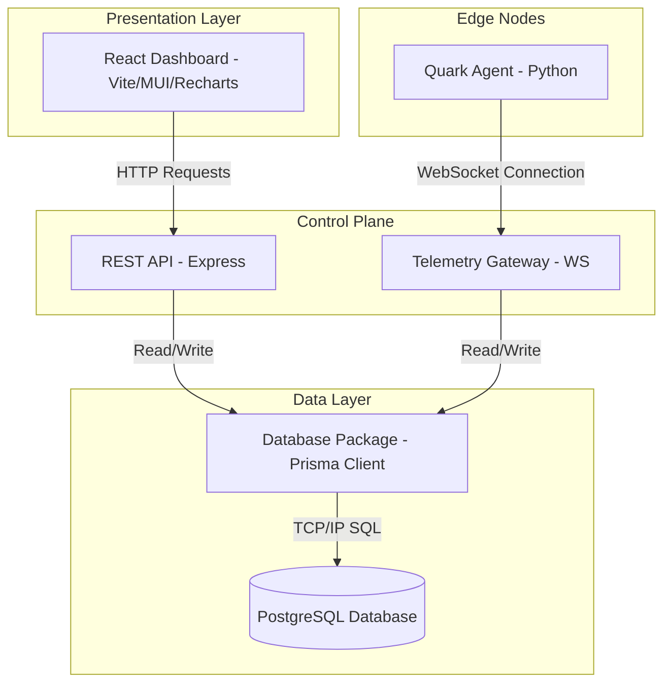
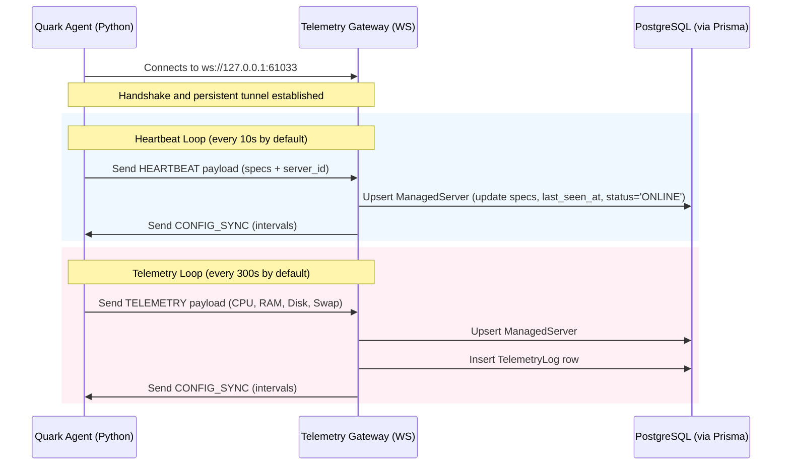
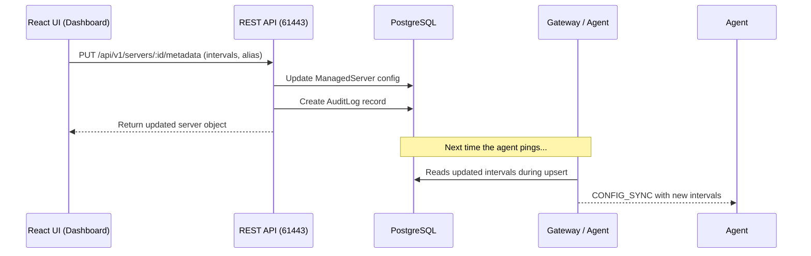

# Nucleus Platform: Codebase Audit & Architecture Map

This document provides a comprehensive technical audit of the **Nucleus Platform**, a Remote Monitoring and Management (RMM) system. It outlines the codebase architecture, maps out system interactions, details critical flaws and risks (security, operational, and visual), and proposes a multi-phase improvement roadmap.

---

## 1. System Architecture Map

The Nucleus Platform is structured as a decoupled, multi-service monorepo:

### Component Details
*   **Edge Nodes (`agents/quark-agent`)**: A Python-based agent utilizing `asyncio`, `websockets`, and `psutil` to run on target servers. It collects hardware specs and pushes telemetry/heartbeats.
*   **Telemetry Gateway (`services/nucleus-gateway`)**: A Node.js WebSocket server (port `61033`) that processes real-time connections from agents, updates server statuses, writes telemetry to the database, and syncs configuration downward.
*   **REST API (`services/nucleus-api`)**: An Express-based API server (port `61443`) that exposes endpoints for the UI to retrieve active servers, fetch telemetry history (with downsampling), update server configurations, and logically decommission nodes.
*   **Database Package (`packages/database`)**: A local workspace package encapsulating Prisma schema and client instantiation to ensure consistent schema access across the API and Gateway.
*   **React Dashboard (`frontend/nucleus-ui`)**: A Vite React application using Material UI and Recharts to visualize fleet status, display live performance gauges, and render historical trends.

---

## 2. Core Workflows & Data Flows

### A. Agent Handshake & Telemetry Flow

### B. User Configuration & Decommissioning Flow

---

## 3. Technical Audit & Code Flaws

### 🚨 Security Risks (Critical Severity)

| Flaw / Risk | Description | Impact |
| :--- | :--- | :--- |
| **No REST API Authentication** | The REST API (`nucleus-api`) does not require API keys, session tokens, or JWTs. Any endpoint can be hit by anyone. | Attackers can fetch system architectures, modify intervals to overwhelm servers, or decommissioning entire fleets. |
| **No WebSocket Gateway Auth** | The Gateway (`nucleus-gateway`) accepts any incoming connection and immediately processes payloads. It registers new IDs and updates existing ones without validating signatures or keys. | An attacker can spoof another node's UUID, sending fraudulent telemetry or spoofing status to hijack a server's profile. |
| **Cleartext Transports (`ws://`, `http://`)** | The communication happens via unencrypted HTTP and WS protocols. | Telemetry metadata, system architectures, IP addresses, and config updates are subject to network eavesdropping and tampering. |
| **Stored XSS Vulnerability** | The `alias` and `group_name` fields are written directly to the database and read by React without sanitization. | If an attacker injects a script into the database via the unauthenticated metadata API, it will run inside the React browser session of administrators. |

### 🛠️ Code Bugs & Operational Issues (Medium Severity)

#### 1. Excessive Database Upserts on Heartbeats
*   **File**: [services/nucleus-gateway/server.js](file:///Users/adil/Documents/Projects/nucleus-platform/services/nucleus-gateway/server.js#L22-L42)
*   **Issue**: On every incoming message (even standard heartbeats sent every 10 seconds), the gateway runs a full `prisma.managedServer.upsert` including static hardware specs (`total_cores`, `total_ram_gb`, `total_disk_gb`, `os_release`). 
*   **Impact**: Unnecessary database write-load. Static details should only be written on initial registration or when changed, rather than rewritten on every single ping.

#### 2. Agent Queue Bloat on Connection Drop
*   **File**: [agents/quark-agent/agent.py](file:///Users/adil/Documents/Projects/nucleus-platform/agents/quark-agent/agent.py#L104-L122)
*   **Issue**: The agent runs three concurrent tasks. If the WebSocket connection is dropped, `comms_worker` enters a retry loop sleeping for 5 seconds. Meanwhile, the `heartbeat_worker` and `telemetry_worker` continue adding payloads to the unbounded `asyncio.Queue`.
*   **Impact**: Memory bloat over long disconnects. Once re-established, a burst of outdated heartbeats/telemetry is dumped to the gateway.

#### 3. Heartbeat Sweeper N+1 Database Calls
*   **File**: [services/nucleus-gateway/server.js](file:///Users/adil/Documents/Projects/nucleus-platform/services/nucleus-gateway/server.js#L73-L94)
*   **Issue**: The sweeper runs every 5 seconds, loads all online servers, and checks their timeouts. If a timeout has occurred, it makes a separate `prisma.managedServer.update` database write *sequentially* within a `for...of` loop.
*   **Impact**: Under large fleet loads, this sequential execution will block the Node.js event loop and lead to high query latency.

#### 4. Sleep Latency in Agent Interval Updates
*   **File**: [agents/quark-agent/agent.py](file:///Users/adil/Documents/Projects/nucleus-platform/agents/quark-agent/agent.py#L68-L89)
*   **Issue**: When the Gateway syncs a new telemetry/heartbeat interval downward, the change is written to `CONFIG`. However, the workers are already in the middle of an `await asyncio.sleep(CONFIG["telemetry"])`.
*   **Impact**: If the telemetry interval is changed from 10 minutes to 1 minute, the worker will still wait out the remainder of its 10-minute sleep before applying the change.

#### 5. Naive Chart Downsampling
*   **File**: [services/nucleus-api/server.js](file:///Users/adil/Documents/Projects/nucleus-platform/services/nucleus-api/server.js#L120-L128)
*   **Issue**: The downsampler uses a simple modulo check (`index % step === 0`) to limit the returned data points to 96.
*   **Impact**: This method is prone to aliasing. It completely ignores telemetry spikes and valleys (e.g., brief CPU spikes to 100% or dips to 0% are missed), leading to smoothed-over, inaccurate graphs.

---

## 4. UI/UX & Functional Gaps

### 🎨 Visual Identity Problems
*   **Basic Light Theme**: The current UI uses the default Material UI mode ('light') with basic blue colors (`#1976d2`) and plain gray boxes. It lacks the modern "wow factor" (e.g., dark mode, glassmorphism, glowing telemetry indicators).
*   **Plain Circular Gauges**: The gauges are stacked MUI circular progress components. They do not render warnings/danger ranges dynamically based on severity or use smooth gradients.

### 🧩 Lacking Features
1.  **Empty Process Telemetry**: The database schema holds `top_processes Json`, but the agent code sets `top_processes: []` and notes `# Omitted for brevity`. Administrators cannot see what is running.
2.  **No Command Execution (Remote Console)**: There is no reverse command-shell or remote task execution pipeline. RMM systems should allow triggering scripts/updates.
3.  **UI is Polling, not Real-time**: The dashboard polls `/servers` every 5 seconds. Since the server already has a WebSocket gateway, real-time UI notifications should be pushed via WebSockets rather than HTTP polling.
4.  **No Dependency/Setup Automation**: There are no files like `requirements.txt` in the agent folder, or setup scripts to easily build/start dependencies.

---

## 5. Architectural Improvements Roadmap

To address these flaws systematically, we can execute the following roadmap:

### Phase 1: Security & Stability (Must-Have)
*   [ ] **API Token Authorization**: Implement simple token/secret validation between the Agent and the Gateway, and JWT or static keys for the REST API.
*   [ ] **Gateway Soft-Delete Management**: Update the Gateway to close the WebSocket connection if the server has been soft-deleted (status `DECOMMISSIONED` / `is_active` false).
*   [ ] **Bounded Agent Queue**: Cap the agent's payload queue length and drop old heartbeat messages to prevent memory growth during offline hours.

### Phase 2: Performance & Optimization
*   [ ] **Split Upsert Queries**: Separate Gateway logic so that Heartbeat payloads only execute a lightweight status/time update, and static details are only updated on telemetry or registration.
*   [ ] **Batch Watchdog Sweeper**: Write a batch update query or parallelize the sweeper's status updates using `Promise.all` to prevent event-loop blockage.
*   [ ] **Dynamic Sleep / CancellationToken**: Implement interruptible sleeps in the agent workers using an event-trigger system instead of static `asyncio.sleep()`.

### Phase 3: Premium UI & Realtime Dashboard
*   [ ] **Ultra-Premium Dark Theme**: Convert the frontend to a custom-designed Dark Mode with responsive grid layouts, glassmorphism cards, glowing telemetry rings, and animated indicators.
*   [ ] **LTTB Chart Downsampling**: Implement the *Largest Triangle Three Buckets* (LTTB) algorithm in the API to preserve peaks/valleys on telemetry charts.
*   [ ] **Websocket Push for UI**: Create a WebSocket endpoint on the gateway that allows the frontend UI to receive real-time status and telemetry events directly.

### Phase 4: Feature Expansion
*   [ ] **Implement Top Processes**: Add process-gathering code to the agent (`psutil.process_iter()`) and display it in a table inside the UI's server card or details dialog.
*   [ ] **Agent Packaging**: Create a proper `requirements.txt` for python packages and setup instructions.
